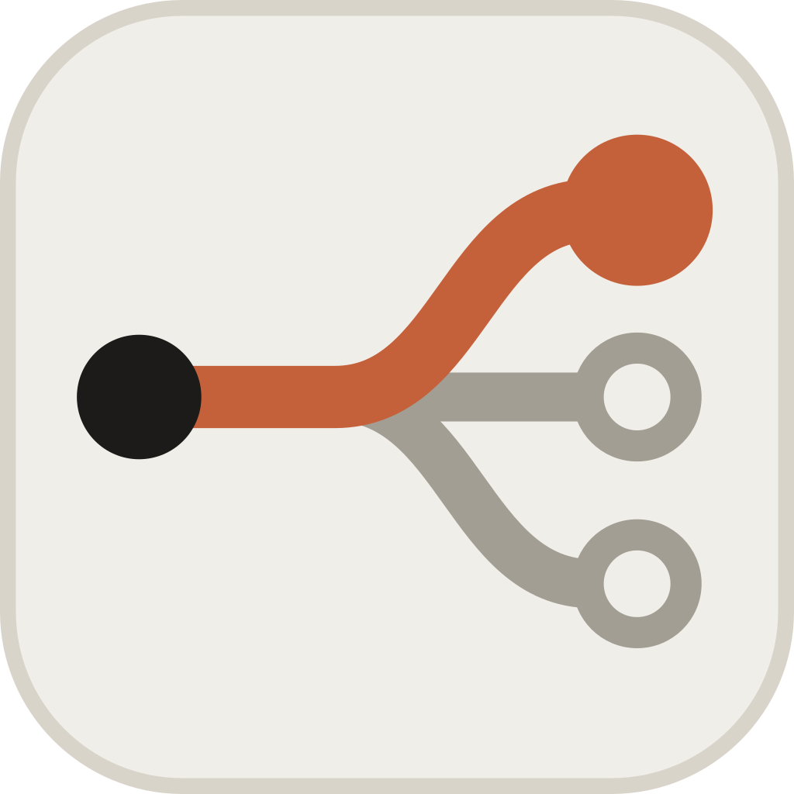
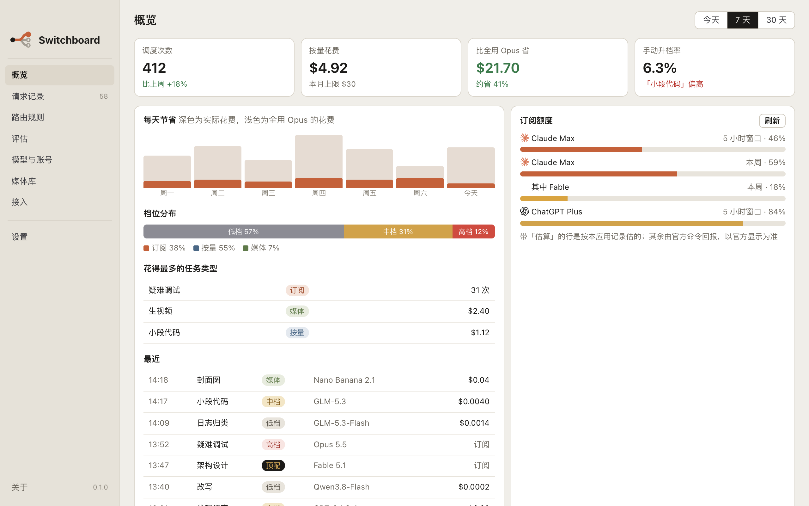
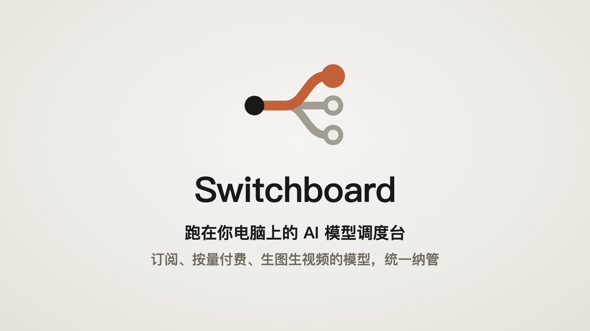
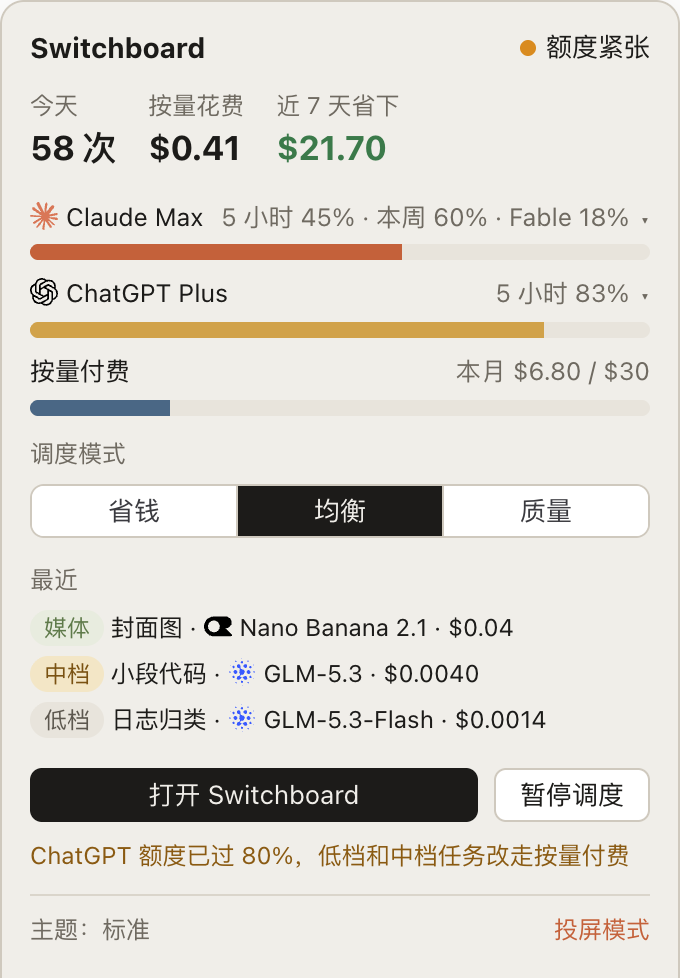
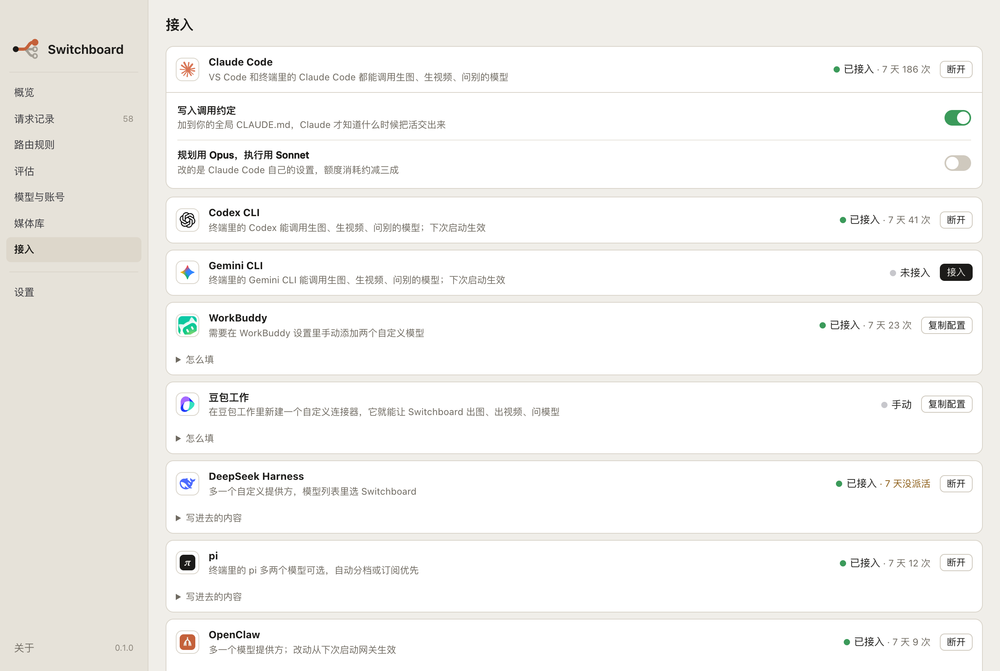
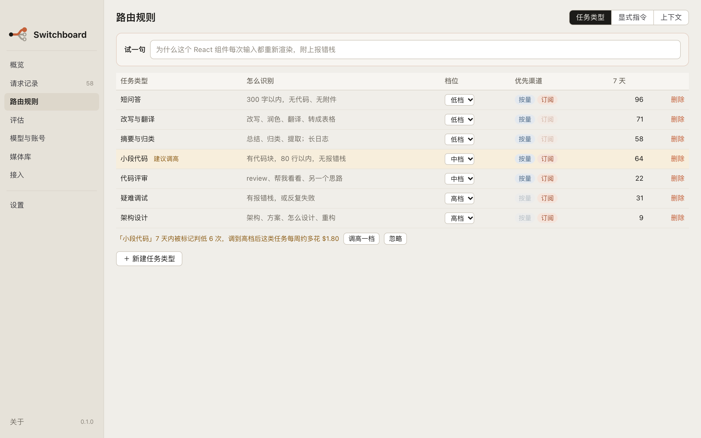

<p align="center"></p>

<h1 align="center">Switchboard</h1>

<p align="center"><b>订阅额度先用，难事交给强模型，杂活交给便宜模型。</b></p>

<p align="center">中文 | <a href="README.en.md">English</a></p>

<p align="center"><a href="https://github.com/imoling/iml-switchboard/actions/workflows/ci.yml"></a> <a href="LICENSE"></a></p>

Switchboard 把你订阅的模型（Claude、ChatGPT、Antigravity）、充值的按量付费模型、生图生视频模型统一管起来，让 Claude Code、Codex、WorkBuddy、Hermes 这些智能体在哪都能用：

- **按难易自动挑模型，能省就省**：杂活给便宜模型，难事给强模型，订阅额度先用。
- **要图就生图，不用切换**：直接调 GPT Image、Nano Banana、火山方舟这些生图模型，产物落到项目里。
- **一个挂了换下一个**：订阅额度用完、限流或报错时，自动换下一个模型，带着同一段对话接着干。
- **哪个宿主都能用上顶级模型**：配好对应的订阅或密钥，Opus、Fable、GPT 这些强模型哪个宿主都调得到（带工具的智能体回合只走按量付费，不走订阅）。

两种用法：

- **派活**：Claude Code、Codex、Gemini CLI 保留自己的主力模型，把翻译、第二意见、生图这些子任务交给 Switchboard（MCP 工具）。主力的上下文和缓存不受影响。
- **当主力模型**：WorkBuddy、pi、OpenClaw、DeepSeek Harness 直接把 Switchboard 当成一个模型（OpenAI 兼容接口）。每次请求带着完整对话，Switchboard 按难易挑模型，一个失败就换下一个接着答。

配一个菜单栏（Windows 上是托盘）应用：看额度、看花费、看省了多少、改规则。

> 支持 macOS 和 Windows。macOS 版在作者的电脑上日常使用；Windows 版已完成移植，每次提交都会在 Windows 上自动跑全部测试，但还没有在真实的 Windows 电脑上手工用过，欢迎反馈。Linux 版能构建，未验证。

<p align="center"></p>

<p align="center"><a href="docs/videos/switchboard-launch.mp4"></a><br><sub>46 秒看懂它在做什么 · <a href="docs/videos/switchboard-launch.mp4">播放视频</a></sub></p>

## 它解决什么

- **订阅额度用不完，按量付费却在涨。** Claude、ChatGPT 的套餐额度经本机官方命令行优先消耗，不够了才改走按量付费，月上限到了就停。
- **什么活都交给最贵的模型。** 规则加低档模型判档，把任务分到低档、中档、高档；只有显式要求、重做或质量模式才用顶配。
- **智能体不会生图、生视频。** 宿主多了生图、生视频、做动画三个工具，产物直接落到项目的 `assets/` 里。

## 和其他工具有什么不同

它们解决的问题不一样，可以一起用。下表依据各自 2026 年 10 月的公开文档整理。

| | Switchboard | [magpie](https://github.com/yetone/magpie) | [cc-switch](https://github.com/farion1231/cc-switch) | [claude-code-router](https://github.com/musistudio/claude-code-router) | [OpenRouter](https://openrouter.ai) |
|---|---|---|---|---|---|
| 主要做什么 | 宿主把子任务派出来，按难度选模型 | 每个智能体用哪个模型，一处管理 | 一键切换工具背后的供应商 | Claude Code 的本地网关 | 云端模型聚合 |
| 和宿主主力模型的关系 | 两种都行：派子任务（不动主力），或直接当主力模型 | 替换主力 | 替换主力 | 替换主力 | 替换主力 |
| 按任务选模型 | 规则 + 低档模型判档，有公开的准确率测试 | 小模型判意图 | 无 | 按场景的规则 | 任务分类 + 全平台消费排名 |
| 订阅额度怎么用 | 只启动未修改的官方命令行（`claude -p`、`codex exec`、`agy -p`），不读登录信息 | 读取 Claude Code、Codex 的登录信息和钥匙串来发现订阅；Claude 部分驱动官方命令行 | 测试版账号功能：登录 Copilot、ChatGPT、Grok 后经本地代理转发 | 不用订阅，用你的 API 密钥 | 不用订阅 |
| 生图、生视频、动画 | 三类都有，各分三档 | 生图工具 | 无 | 无 | 有模型，需自己调用 |
| 平台 | macOS、Windows（Linux 未验证） | macOS、Windows、Linux | macOS、Windows、Linux | macOS、Windows、Linux | 云端 |

各厂商对「第三方工具使用订阅额度」的规定差别很大：Anthropic 允许本人在本机调用未修改的 `claude` 命令行，但禁止第三方客户端拿订阅凭据直连（[原文](https://code.claude.com/docs/en/legal-and-compliance)）；Google 明确规定第三方软件直连 Gemini CLI 背后的服务可停号（[原文](https://geminicli.com/docs/resources/tos-privacy/)）；OpenAI 提供官方的「Sign in with ChatGPT」通道。用任何工具之前，都建议读一下你所用套餐的条款。

## 合规边界

这几条写在代码里，并有测试守着，改坏了测试就过不去：

1. 不读取、不存储、不转发任何订阅凭据（`~/.claude/.credentials.json`、钥匙串里的登录项、`~/.codex/auth.json`、`~/.gemini/oauth_creds.json`）。
2. 不伪装官方客户端的请求头。
3. 订阅额度只由未修改的官方命令行子进程消耗；启动前清掉 `ANTHROPIC_API_KEY` 等会改走按量付费的环境变量，永远不传 `--bare`。
4. 只监听 `127.0.0.1`。
5. 不做多账号轮换、不做额度预热、不把订阅经代理转给别的程序。

测试分三层：扫描源码；用假的命令行在运行时检查子进程真正收到的参数和环境变量；每天读一次官方命令行的帮助，参数变了就提醒。

## 功能

**调度**
- 低档、中档、高档三档，加只在显式要求时才用的顶配；省钱、均衡、质量三种调度模式。
- 规则拿不准时，先请低档模型判一次档，10 秒内判不出就照规则走。
- 订阅额度用完、限流或报错时，自动换下一个候选模型，同一段对话照样带过去。
- 选模型时检查上下文窗口，装不下就换窗口更大的；谁都装不下时返回标准的 `context_length_exceeded`，让宿主自己压缩。
- 「判低了」一键标记，攒够了会建议调整规则；评估功能抽样重做、盲评，看便宜模型的结果够不够好。

**渠道**
- 订阅：Claude（`claude -p`）、ChatGPT（`codex exec`）、Antigravity（`agy -p`）。常驻时会提前启动好下一个进程，实测 Claude 从 7.5 秒降到约 4 秒，Antigravity 从 32 秒降到约 5 秒。
- 按量付费：智谱、阿里云百炼、DeepSeek、Moonshot、MiniMax、火山方舟、OpenRouter、Anthropic、Agnes AI、302.ai。密钥存在系统自带的凭据库里：macOS 钥匙串、Windows 凭据管理器。
- 媒体：生图、生视频分便宜档、默认档、最好档；动画由模型写 Remotion 代码，在本机渲染成视频。

**接入的宿主**

| 宿主 | 接入方式 | 实测 |
|---|---|---|
| Claude Code | MCP 工具 + `CLAUDE.md` 调用约定 + 斜杠命令 | 已在本机日常使用 |
| Codex CLI | MCP 工具 + `AGENTS.md` 调用约定 | 已注册；派活流程用模拟宿主验证 |
| Gemini CLI | MCP 工具 + `GEMINI.md` 调用约定 | 已注册；个人账号已被 Google 迁到 Antigravity，需 API 密钥或企业账号 |
| pi | 兼容入口（OpenAI 格式） | 带工具的智能体回合实测通过 |
| OpenClaw | 兼容入口 | 带工具的智能体回合实测通过 |
| DeepSeek Harness | 兼容入口 | 带工具的智能体回合实测通过 |
| Hermes Agent | MCP 工具 + 生图配置 | 接入代码有测试，未在真实环境跑过 |
| WorkBuddy | 兼容入口 | 带工具的回合实测通过；说「生成图片」直接走 Switchboard 的渠道出图 |
| 豆包工作 | 自定义连接器（MCP） | 手动配置 |

<table>
<tr>
<td width="34%"></td>
<td><br></td>
</tr>
<tr>
<td align="center">菜单栏：今天花了多少、额度、调度模式</td>
<td align="center">接入各个宿主，看每家派了多少活；路由规则可直接改</td>
</tr>
</table>

**其他**
- 账本：每次调用的模型、花费、全用 Opus 的对照价，菜单栏显示近 7 天省了多少；费用可按人民币或美元显示。
- 风格主题：标准、点将台、后宫、海王，只换界面说法；投屏时一键切回标准。
- 后台服务：设置里能看到运行多久、一键重启；连着的后台不是当前安装包里那份时会提示。
- 检查更新：每天到 GitHub Releases 查一次，连不上就查 Gitee 镜像；有新版本通知一声，设置里一键下载本平台的安装包。

## 安装

**用安装包**：在 [Releases](https://github.com/imoling/iml-switchboard/releases) 页下载对应系统的安装包（macOS 是 dmg，Windows 是 msi 或 exe）。安装包里已经带了后台程序 `imls`。

还需要至少一个已登录的官方命令行（`claude`、`codex` 或 `agy`），或一个按量付费账号。

**从源码构建**：需要 Go 1.27+、Node 20.19+、Rust。

```sh
git clone https://github.com/imoling/iml-switchboard.git && cd iml-switchboard

# 后台服务和命令行（Windows 上写成 go build -o bin\imls.exe ./cmd/imls，之后用 .\bin\imls.exe）
go build -o bin/imls ./cmd/imls
./bin/imls doctor          # 检查本机命令行、账号、密钥存储、代理设置
./bin/imls install         # 注册开机自启（也可以 ./bin/imls serve 前台运行）

# 桌面应用：构建时会按目标平台编译一份 imls 一起打包
cd ui && npm install && npm run tauri build
```

| | macOS | Windows |
|---|---|---|
| 数据目录 | `~/Library/Application Support/Switchboard` | `%AppData%\Switchboard` |
| 快速面板快捷键 | ⌥ Space | Ctrl + Alt + Space |
| 密钥存放 | 钥匙串 | 凭据管理器（「Windows 凭据」里的 iML Switchboard 条目） |
| 开机自启 | launchd | 当前用户的「登录时启动」项 |

打开应用，首次引导会带你检测本机命令行、添加一个按量付费账号、接入 Claude Code，然后试一句。

终端里设了全局代理时，记得加上 `NO_PROXY=127.0.0.1,localhost`，否则 pi、OpenClaw 这些宿主会把发往本机的请求也交给代理。

## 用起来

接入 Claude Code 后，它多了五个工具：`ask_model`（问别的模型）、`generate_image`、`generate_video`、`make_animation`、`get_job`（查媒体任务进度）。平时直接说「配一张封面图」「请另一个模型评审一下」就行。

命令行：

```sh
imls route "这个登录接口一直 500，试了很多次还是不行"   # 只看会派给谁、为什么
imls route --run "把这段话翻译成英文：……"              # 真正执行
imls stats                                            # 近 7 天的花费和节省
imls golden                                           # 导出「判低了」的请求，补进路由测试
```

更多见[使用指南](docs/使用指南.md)，接口说明见 [docs/API.md](docs/API.md)。

## 路由准确率

路由规则有两套测试数据：105 条调规则用的金标集，60 条由另一个模型独立出题、标注的盲测集（调规则时不看）。

| | 盲测集准确率 | 判低了 |
|---|---|---|
| 只靠规则（旧版） | 46.7% | 51.7% |
| 只靠规则（现在） | 65.0% | 33.3% |

规则判不准的大多是「没有关键词的难题」，所以拿不准时会再请低档模型判一次。这些数字样本还小，只当方向参考；`go test ./internal/core -run Tiers -v` 可以自己跑。

## 已知限制

- Windows 版还没有在真实电脑上手工用过；安装包暂未签名，macOS 会提示「无法验证开发者」，Windows 会出现 SmartScreen 提示。
- 带系统提示的 Claude 请求不预热（兼容入口转来的请求多半带系统提示）。
- Codex 订阅渠道的派活流程、Hermes 的带工具回合还没有在真实环境完整跑过。
- 不会替宿主压缩对话：只返回标准错误，由宿主自己压缩。

## 路线图

- 签名安装包和应用内静默更新（现在是检查新版本后给下载）；Linux 版验证。
- Claude Code 订阅额度用完时，可以改连 Switchboard，用按量付费模型接着干（走 API 密钥，不碰订阅）。
- 订阅渠道限速；兼容入口默认不把整轮对话交给 Claude 订阅。
- 扩充路由测试数据，盲测集扩到 200 条。
- Copilot CLI 订阅渠道（走官方命令行）。
- 用真实密钥逐个验证全部按量付费和媒体渠道。

## 开发

```sh
make test          # go vet + go test，含金标集、盲测集、合规测试（CI 在 macOS、Windows、Linux 上都跑）
make ui-check      # 界面类型检查、测试、构建
cd ui && npm run tauri dev
```

项目约定（术语表、界面文案、红线）见 [CLAUDE.md](CLAUDE.md)，界面开发见 [ui/README.md](ui/README.md)。

## 许可

[MIT](LICENSE)

Switchboard 与 Anthropic、OpenAI、Google 没有任何关联。Claude、ChatGPT、Codex、Gemini、Antigravity 是各自公司的商标。

iML Studio 出品 · © 2026 imoling
